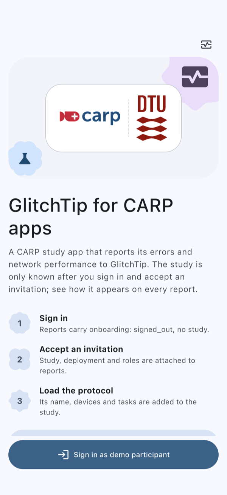
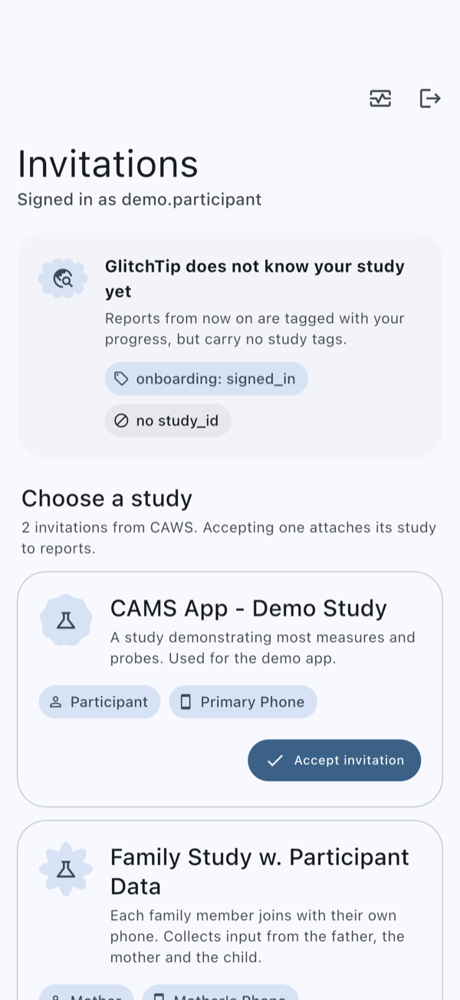
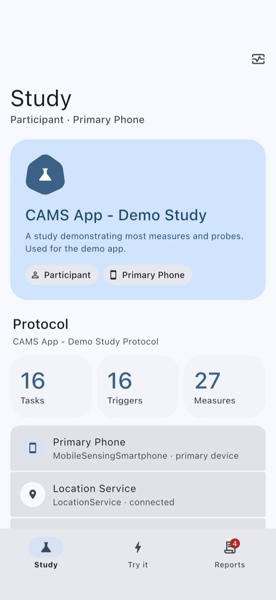
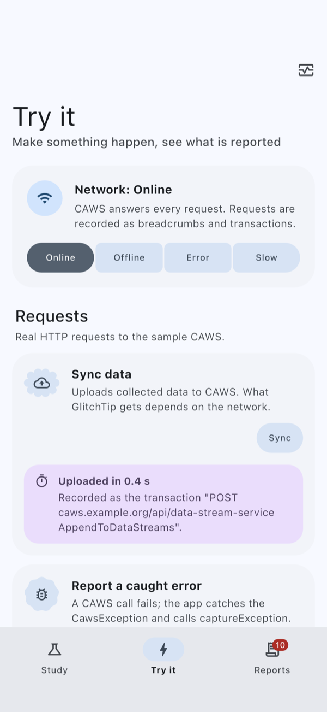
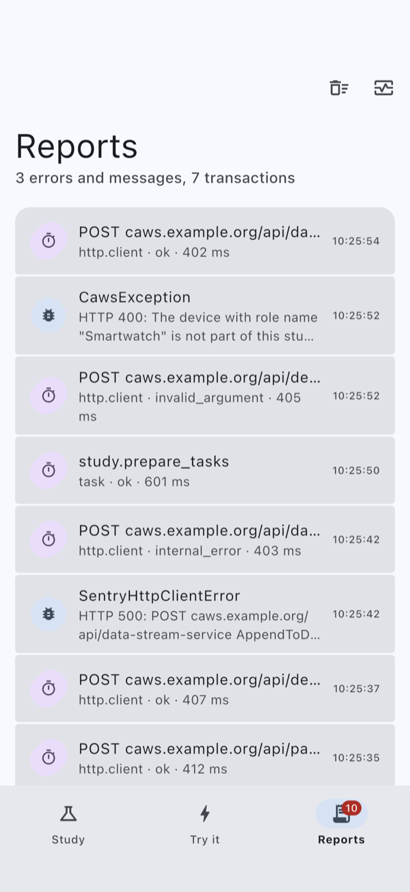
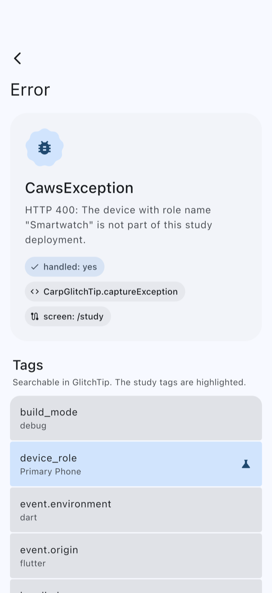

# CARP GlitchTip Wrapper

<p>
  <a href="https://carp.dk"></a>
  <a href="https://pub.dev/packages/carp_glitchtip_wrapper"></a>
  <a href="https://pub.dev/packages/carp_glitchtip_wrapper/score"></a>
  <a href="https://pub.dev/packages/carp_glitchtip_wrapper/score"></a>
  <br>
  <a href="https://flutter.dev"></a>
  <a href="#supported-platforms"></a>
  <a href="#supported-platforms"></a>
  <a href="https://glitchtip.com"></a>
  <a href="LICENSE"></a>
  <br clear="right">
</p>

A Flutter package for error and network-performance reporting to a self-hosted [GlitchTip](https://glitchtip.com) server, made by the [Copenhagen Research Platform (CARP)](https://carp.dk) at the [Technical University of Denmark (DTU)](https://dtu.dk) for its apps.

GlitchTip uses the Sentry protocol, so the package wraps the [Sentry Flutter SDK](https://pub.dev/packages/sentry_flutter) and sets it up the same way in every app: configured from env defines, with the participant's study on every report, with network performance recorded, with the errors CARP packages throw while offline ignored, and with a privacy policy fit for health research.

**Contents:** [Features](#features) · [Platforms](#supported-platforms) · [Installation](#installation) · [Quick start](#quick-start) · [Usage](#usage) · [Privacy](#privacy) · [Testing](#testing) · [Migrating](#migrating-a-carp-app) · [Example app](#example-app) · [Contributing](#contributing) · [License](#license)

## Features

* **Setup from env**: the DSN and every other setting come from `--dart-define` / `--dart-define-from-file` (`GLITCHTIP_DSN`, ...), so builds and CI decide where and whether to report
* **Study metadata**: once the participant has accepted a study invitation, every report carries the study (`study_id`, `study_deployment_id`, `device_role`, `participant_role`) as searchable tags, kept in sync with the app
* **Network performance**: every request made with `package:http`, also those inside CARP packages such as `carp_webservices`, is recorded as a breadcrumb and, when sampled, as a GlitchTip transaction per endpoint (count, average, p50/p95 duration, error rate)
* **Ignore expected errors**: the network errors CARP packages throw while the phone is offline ("Failed host lookup", ...) are ignored by default, and apps add their own rules
* **GlitchTip-ready**: the settings GlitchTip needs (e.g. classic transactions instead of streamed spans) are applied for you
* **Privacy-safe by default**: no personal data, no screenshots, scrubbed URLs and messages, no device events of the participant
* **Testable**: `GlitchTipTestTransport` shows in a unit test exactly what an app would report

## Supported platforms

| Platform | Supported | Minimum version | Notes |
|---|:---:|---|---|
| Android | ✅ | API 26 (Android 8.0) | Required by `sentry_flutter` 10. |
| iOS | ✅ | iOS 15.0 | Use [Swift Package Manager](https://docs.flutter.dev/packages-and-plugins/swift-package-manager/for-app-developers): `sentry_flutter` 10 no longer supports CocoaPods. |

**Toolchain:** Flutter 3.44 or later and Dart 3.12 or later (required by `sentry_flutter` 10). **Server:** GlitchTip 6.2 or later is recommended.

## Installation

```sh
flutter pub add carp_glitchtip_wrapper
```

It is the only dependency an app needs: the Sentry types used by its API are re-exported.

### Android

Raise the minimum SDK in `android/app/build.gradle.kts` (Flutter's default, 24, fails the manifest merge):

```kotlin
defaultConfig {
    minSdk = 26
}
```

Also turn off the Android SDK's network breadcrumbs, see [Privacy](#privacy).

### iOS

Set the deployment target to iOS 15.0. The app must use Swift Package Manager, which is on by default in current Flutter versions; if it was turned off, turn it on again:

```sh
flutter config --enable-swift-package-manager
```

## Quick start

Wrap the **whole** body of `main()` in `CarpGlitchTip.runZoned` and call `CarpGlitchTip.init` in it:

```dart
import 'package:carp_glitchtip_wrapper/carp_glitchtip_wrapper.dart';

Future<void> main() => CarpGlitchTip.runZoned(() async {
  WidgetsFlutterBinding.ensureInitialized(); // may stay, now a no-op
  await CarpGlitchTip.init(const CarpGlitchTipOptions());

  // ... the rest of the app's startup, unchanged
  runApp(const MyApp());
});
```

Then pass the DSN of the GlitchTip project when building or running:

```sh
flutter run --dart-define=GLITCHTIP_DSN=https://<key>@<glitchtip-host>/<project-id>
```

`runZoned` creates the Flutter binding inside a zone in which every `http.Client()` records its requests, also the clients `carp_webservices` and the OIDC login create internally. Note:

* **Nothing may run before it.** Debug builds assert that no binding was created earlier.
* **Call `init` only from `main()`**, never from background entry points (WorkManager, push or notification handlers). The native SDKs are shared by the whole process.

Reporting is **off in debug builds** unless `GLITCHTIP_ENABLED=true` is set, so local development does not pollute GlitchTip, and off under `flutter test` unless `enabled: true` is passed in code. At startup the wrapper prints one status line, also in release builds (logcat / Xcode console):

```text
[CarpGlitchTip] enabled env=production release=... dsn=glitchtip.example.com/7 errors=1.0 traces=0.1 http=0.1
[CarpGlitchTip] DISABLED: debug build; set GLITCHTIP_ENABLED=true to report
```

If the Sentry SDK needs longer than `initTimeout` (5 s by default) to start, `init` returns and prints `starting (after 5000 ms): env=...` instead. Errors are already reported then. The `enabled` line follows once the SDK has started, and from then on requests, traces and navigation are recorded too.

The same information is available as `CarpGlitchTip.status`, e.g. for an about or debug screen.

## Usage

Import `package:carp_glitchtip_wrapper/carp_glitchtip_wrapper.dart`. Everything goes through the static `CarpGlitchTip` facade, configured with `CarpGlitchTipOptions`. All methods are safe to call at any time, and the wrapper's own failures will not throw.

### Configuration

#### Env keys

| Key | Default | Meaning |
|---|---|---|
| `GLITCHTIP_DSN` | – | The project DSN. Reporting is off without a valid one. Only `https` is accepted; debug builds also accept `http` for a server on the development machine (`localhost`, `127.0.0.1`, `10.0.2.2`). Falls back to `SENTRY_DSN`. |
| `GLITCHTIP_ENABLED` | `false` in debug, `true` otherwise | Turns reporting on or off. |
| `GLITCHTIP_ENVIRONMENT` | `deployment-mode`, else `production` | The environment. Debug and profile builds get a `-debug` / `-profile` suffix (e.g. `production-debug`). Falls back to `SENTRY_ENVIRONMENT`. |
| `GLITCHTIP_RELEASE` | `<package>@<version>+<build>` | The release. Falls back to `SENTRY_RELEASE`. |
| `GLITCHTIP_DIST` | the build number | The distribution. Falls back to `SENTRY_DIST`. |
| `GLITCHTIP_SAMPLE_RATE` | `1` | Share of error events sent. |
| `GLITCHTIP_TRACES_SAMPLE_RATE` | `0.1` in release, else `0` | Share of `CarpGlitchTip.trace` and app-start transactions sent. |
| `GLITCHTIP_HTTP_SAMPLE_RATE` | `0.1` in release, else `0` | Share of network requests recorded as transactions. |
| `GLITCHTIP_DEBUG` | SDK default | `true` prints the Sentry SDK's diagnostics. |

CARP's existing `deployment-mode` launch argument (`production`, `test`, `dev`, ...) is used as the environment and added as the `deployment_mode` tag. `debug-level` is not used.

#### Precedence

Values in `CarpGlitchTipOptions` are the app's **defaults**; env keys override them per build or at runtime:

1. The `GLITCHTIP_*` key, then its `SENTRY_*` alias, from `CarpGlitchTipOptions.env` (e.g. the CARP debug toolkit's runtime overrides), then from `--dart-define`.
2. The value in `CarpGlitchTipOptions`.
3. A value derived by the wrapper (the environment from `deployment-mode`).
4. The wrapper's default.

`CarpGlitchTipOptions.configure` runs last and can change any other Sentry option. Afterwards, the wrapper re-applies what GlitchTip and the privacy policy depend on (see [Privacy](#privacy)).

#### Runtime overrides (CARP debug toolkit, dotenv)

```dart
// neuropathy-app: DebugEnv overrides are loaded first, then read through the
// app's debugLaunchOverride hook, e.g. to switch GLITCHTIP_ENABLED on
if (kDebugMode) await debug.initializeDebugTools();
await CarpGlitchTip.init(CarpGlitchTipOptions(env: debugLaunchOverride));

// flutter_dotenv
await dotenv.load();
await CarpGlitchTip.init(
  CarpGlitchTipOptions(env: GlitchTipEnv.fromMap(dotenv.env)),
);
```

Any `String? Function(String key)` works as a source, and `GlitchTipEnv.chain([...])` combines several.

#### Define files and CI

Keys work on the command line, in `.json` and in `.env` define files. CARP's kebab-case keys (`deployment-mode`) are only valid in JSON files, so keep one JSON file per deployment mode, e.g. `dart_defines/production.json`:

```json
{
  "deployment-mode": "production",
  "GLITCHTIP_DSN": "https://<key>@<glitchtip-host>/<project-id>"
}
```

```sh
flutter build appbundle --dart-define-from-file=dart_defines/production.json
```

Paths are relative to the project root, also when the command runs in `ios/` or `android/`. A `--dart-define` given on the command line wins over files.

The DSN is not a secret (it is embedded in the app binary anyway), but keep it out of public repositories. When it comes from a CI secret, make the build fail instead of silently shipping without reporting. An **empty** define overrides the value from a file:

```sh
# Xcode Cloud (ci_post_clone.sh) / any shell
: "${GLITCHTIP_DSN:?add GLITCHTIP_DSN as a secret variable}"
flutter build ios --config-only --dart-define="GLITCHTIP_DSN=$GLITCHTIP_DSN" ...
```

```yaml
# GitHub Actions
env:
  GLITCHTIP_DSN: ${{ secrets.GLITCHTIP_DSN }}
```

### Study metadata

In most CARP apps the study is only known after the participant has signed in and accepted a study invitation, and the protocol only after the study deployment has been loaded. The wrapper follows the app through these steps:

| Step | What reports carry |
|---|---|
| Before sign-in, and before an invitation is accepted | No study. Errors in the sign-in and invitation screens are still reported; an app tag can tell these steps apart (see the [example app](#example-app)). |
| The participant accepts an invitation | The study as searchable tags: `study_id`, `study_deployment_id`, `device_role` and `participant_role`, and the same values in a `study` context. |
| The deployment and its protocol are loaded | Whatever helps to triage, added to the same study: `context` (shown on each report) and a few low-cardinality `tags`. |
| The participant leaves the study | No study again, and the breadcrumbs recorded during the study are cleared. |

Map the app's study object once and bind it to the app's state. The wrapper then reads it again whenever the state changes and whenever an error is reported:

```dart
extension on SmartphoneStudy {
  StudyMetadata toGlitchTip() => StudyMetadata(
    studyId: studyId,
    studyDeploymentId: studyDeploymentId,
    deviceRoleName: deviceRoleName,
    participantRoleName: participantRoleName,
    // known once the deployment, with its protocol, is loaded
    context: {'protocol': ?deployment?.studyDescription?.title},
  );
}

// once the app's BLoC exists (CARP BLoCs are ChangeNotifiers)
CarpGlitchTip.bindStudy(bloc, () => bloc.study?.toGlitchTip());
```

Apps without CARP Mobile Sensing can map carp_core's `ActiveParticipationInvitation` the same way: it has `studyId`, `studyDeploymentId`, `deviceRoleName`, `participantRoleName` and `studyName`.

Or set the study explicitly with `CarpGlitchTip.setStudy(...)` and `CarpGlitchTip.clearStudy()`. Values set before `init` are kept and applied at init. Do not put the participant id, names or e-mail addresses into the study: a study deployment id already is a pseudonym of the participant.

Add other information with `CarpGlitchTip.setTags({...})` (searchable) and `CarpGlitchTip.setContext('name', {...})` (shown on each report). Keys the Sentry SDK or the wrapper own (`app`, `device`, `os`, `study`, ...) are ignored. Tags and contexts are sent as given, so keep personal data out of them.

Useful searches in GlitchTip:

| Search | Finds |
|---|---|
| `study_deployment_id:<id>` | everything from one participant's deployment |
| `study_id:<id>` | everything from one study |
| `participant_role:Mother` | everything from one participant role |
| `handled:no` | errors the app did not catch |
| `build_mode:release` | only release builds |
| `deployment_mode:test` | only the test deployment |
| `screen:/tasks` | errors on one screen (needs `navigatorObserver()`) |

### Network performance

Inside `runZoned`, every request made with `package:http` is recorded:

* A **breadcrumb**: method, URL without query, status and duration.
* When sampled (`GLITCHTIP_HTTP_SAMPLE_RATE`), a **transaction** named after the request, e.g. `GET cans.cachet.dk/api/studies/{uuid}/files`. Ids in paths become placeholders, so GlitchTip groups the requests per endpoint. CARP Web Services RPC calls are named after their operation, e.g. `POST cans.cachet.dk/api/deployment-service GetStudyDeploymentStatus`.
* An **error event** when a request fails unexpectedly: a 5xx response, or an exception that is not ignored (e.g. a refused connection or a TLS error). The same failure is reported at most once per 10 minutes, so the 15 retries of a `carp_webservices` call do not flood GlitchTip.

Recording does not change a request: the response or the original exception reaches the caller unchanged.

```dart
await CarpGlitchTip.init(
  CarpGlitchTipOptions(
    http: HttpOptions(
      // hide secrets in paths (CAWS self-signup codes are always hidden)
      pathTemplates: [PathTemplate(RegExp(r'/invite/[^/]+'), '/invite/{code}')],
      excludeUrls: ['https://tiles.example.com'],
      isFailedStatus: (status) => status >= 500 || status == 429,
    ),
  ),
);
```

Time other work, e.g. the app's startup, with `trace`:

```dart
await CarpGlitchTip.trace('bloc.initialize', bloc.initialize);
```

Not recorded are requests made by native code (e.g. `flutter_appauth`), in other isolates, and by clients created outside the zone (wrap those with `CarpGlitchTip.httpClient(client)`). To use another HTTP client implementation (e.g. `cupertino_http`), pass it as `runZoned(..., innerClient: ...)` instead of an own `http.runWithClient` inside `main()`.

### Ignoring errors

By default, `CarpGlitchTipOptions.offlineErrors` ignores the transient network failures that CARP packages throw while the phone is offline:

* DNS failures: "Failed host lookup", "nodename nor servname provided", "No address associated with hostname".
* An unreachable network: "Network is unreachable", "The Internet connection appears to be offline".
* Reset or aborted connections, and request timeouts.

A bare `TimeoutException` (what `carp_webservices` throws after its retries) is only ignored while the network looks offline, judged by the recent requests. A refused connection (the server is down), TLS errors and HTTP error responses are still reported, as is any error that stops the app from starting.

Add the app's own rules:

```dart
await CarpGlitchTip.init(
  CarpGlitchTipOptions(
    ignoreErrors: [
      // by type, optionally narrowed by a typed predicate or a message
      IgnoreType<PlatformException>(where: (e) => e.code == 'discovery_failed'),
      // by message: String = contains, RegExp = hasMatch
      IgnoreRule.message('Location services are disabled'),
      // anything else
      IgnoreRule.custom((c) => c.isHttp && c.statusCode == 503),
      // only while the phone looks offline
      IgnoreType<TimeoutException>().whenOffline(),
    ],
    // CarpServiceException has no toString(); describe it for rules and titles
    describeError: (e) => e is CarpServiceException ? e.message : null,
  ),
);
```

To still see network failures while the phone is online, refine the default rule with the app's connectivity state, or set it to `null` to report all of them:

```dart
CarpGlitchTipOptions(offlineErrors: IgnoreRule.offline().when(() => !isOnline))
```

Native crashes and ANRs are reported by the native SDKs directly; Dart rules do not apply to them.

### Navigation

Add an observer to every navigator, e.g. to `GoRouter(observers: [...])` and to each `ShellRoute(observers: [...])`. Navigation is recorded as breadcrumbs (route names only, no arguments), and the current route becomes the `screen` tag. A route seen by several observers is recorded once.

```dart
GoRouter(observers: [CarpGlitchTip.navigatorObserver()], routes: [...]);
```

Use it instead of Sentry's own `SentryNavigatorObserver`, which records a transaction per screen and binds it to the scope.

## Privacy

The wrapper applies a privacy policy suitable for health research, also when an app changes Sentry options through `configure`.

| Collected | Not collected |
|---|---|
| Errors with stack traces; exception messages with URLs normalised and tokens, e-mail and MAC addresses replaced | Personal data (`sendDefaultPii`), request bodies, headers, cookies |
| Study, deployment, device role and participant role (tags) | User names, e-mail addresses, account or participant ids; a random id per app launch replaces the user |
| Environment, release, build mode | The persistent installation id (Android) and vendor hash (iOS) on Dart events |
| OS, device model, locale, timezone, a snapshot of the device state (battery, charging, connection type, orientation) and, on Android, which permissions are granted | Screenshots, view hierarchy, session replay, accessibility settings |
| Request method, URL without query (ids and secrets replaced by placeholders), status, duration | Query strings, route arguments, JWTs, bearer tokens |
| Navigation and app lifecycle breadcrumbs | Log output (`debugPrint`), structured logs and metrics (unless an app sets `beforeSendLog` / `beforeSendMetric` in `configure`; their texts are then scrubbed and the user replaced), native device events (screen on/off, battery, connectivity) |

A study deployment id is a pseudonym of a participant: treat GlitchTip data as pseudonymised personal data in the study's DPIA.

> [!IMPORTANT]
> Native crash, ANR and app-hang reports are created by the native SDKs and won't pass Dart code. They carry the scope (study tags, the per-launch user) and the breadcrumbs above, but also:
>
> * on Android, the device context with the persistent installation id;
> * on iOS, the vendor hash in the app context;
> * on Android, network breadcrumbs (network type, VPN, signal strength), unless the app turns them off in `android/app/src/main/AndroidManifest.xml`:
>
>   ```xml
>   <application ...>
>     <meta-data
>       android:name="io.sentry.breadcrumbs.network-events"
>       android:value="false" />
>   </application>
>   ```
>
> In the first moments of a launch, before `init` set the per-launch user, a native report can also carry the installation id as user id.

### Server checklist

* Keep *Scrub IP addresses* on for the organisation and the project (GlitchTip stores the sender's IP, truncated, on every event).
* Set the event retention (`GLITCHTIP_EVENT_RETENTION_DAYS`) to what the DPIA allows, and restrict who is a member of the organisation.
* GlitchTip's performance view cannot filter by environment: use one project (DSN) per app and deployment mode, or keep `GLITCHTIP_HTTP_SAMPLE_RATE=0` outside production.
* Request transactions show up on the *Performance* page as one group per endpoint. Spans inside transactions are only stored when `GLITCHTIP_ENABLE_DUCKDB=true`; the wrapper does not need them.

## Testing

Reporting is off under `flutter test` unless `enabled: true` is passed in code. To check what an app reports, e.g. that its ignore rules drop the expected errors and only those, use the test transport:

```dart
import 'package:carp_glitchtip_wrapper/testing.dart';

late GlitchTipTestTransport transport;

setUp(() async {
  await CarpGlitchTip.resetForTest(); // init only works once otherwise
  transport = GlitchTipTestTransport();
  await CarpGlitchTip.init(CarpGlitchTipOptions(
    enabled: true,
    dsn: 'https://key@glitchtip.example.com/1',
    ignoreErrors: myRules,
    configure: (options) => options.transport = transport,
  ));
});
tearDown(CarpGlitchTip.resetForTest);

test('my rules drop expected errors only', () async {
  expect(CarpGlitchTip.isEnabled, isTrue);
  await CarpGlitchTip.captureException(StateError('a real bug'));
  await CarpGlitchTip.captureException(MyExpectedError());
  expect(transport.events, hasLength(1));
});
```

Events and transactions of HTTP requests are captured in the background, so wait a moment before asserting on them.

To test the app's own HTTP requests too, e.g. those of `carp_webservices`, run the widget test's body in `CarpGlitchTip.runZoned` as `main()` does, with a fake backend as `innerClient`. A widget test runs in fake time, where the Sentry SDK's own async work does not finish: call `init` inside `tester.runAsync`, and wait for reports by alternating `tester.runAsync` with `tester.pump`, as the example's `startApp` and `pumpUntil` do. Under `flutter test`, an error escaping the body (such as a failed expectation) is rethrown at once, so the test fails instead of waiting for its report. The [example app's tests](example/test) go through a whole sign-in, invitation and study flow this way.

## Migrating a CARP app

1. Raise the app's Flutter constraint (and CI) to 3.44 or later, the Android `minSdk` to 26 and the iOS deployment target to 15.0, and move iOS to Swift Package Manager.
2. Wrap the existing body of `main()` in `CarpGlitchTip.runZoned`, and call `CarpGlitchTip.init` after the debug toolkit loaded its overrides and before `bloc.initialize()`:

   ```dart
   Future<void> main() => CarpGlitchTip.runZoned(() async {
     WidgetsFlutterBinding.ensureInitialized();
     CarpMobileSensing.ensureInitialized();
     if (kDebugMode) await debug.initializeDebugTools();
     await CarpGlitchTip.init(CarpGlitchTipOptions(
       env: debugLaunchOverride,
       describeError: (e) => e is CarpServiceException ? e.message : null,
     ));
     CarpGlitchTip.bindStudy(bloc, () => bloc.study?.toGlitchTip());
     await CarpGlitchTip.trace('bloc.initialize', bloc.initialize);
     runApp(const App());
   });
   ```

3. Add the `toGlitchTip()` mapping of the app's study (see [Study metadata](#study-metadata)).
4. Add `CarpGlitchTip.navigatorObserver()` to the router and its shell routes.
5. Turn off Android network breadcrumbs in the app's manifest (see [Privacy](#privacy)).
6. Pass `GLITCHTIP_DSN` in each build (define files or CI secret), and check the status line in the build log or the app's log.

## Example app

The [`example/`](example) folder contains a CARP-style app that goes through the usual participant flow against a sample CARP Web Services backend built into the app: sign in, accept a study invitation, load the study protocol, and use the study. On the way it shows what the wrapper attaches to reports, and lets you try what is reported and what is ignored: caught and unhandled errors, offline and failing uploads, an error with an e-mail address and a token (both scrubbed) and traced tasks. The sample invitations and protocol come from the public [CARP Mobile Sensing](https://github.com/carp-dk/carp.sensing-flutter) repository.

Without a DSN it runs in a preview mode that keeps the reports on the device and shows them in the app as GlitchTip would get them (except the native SDK's own reports, e.g. of native crashes). To report to GlitchTip, call `flutter run` from `example/` with `--dart-define=GLITCHTIP_DSN=...` (and `--dart-define=GLITCHTIP_ENABLED=true` in debug builds, where the trace and HTTP sample rates are 0 unless set). The example needs Flutter 3.47 or later, as it uses the [`material_ui`](https://pub.dev/packages/material_ui) and [`material_3_expressive`](https://pub.dev/packages/material_3_expressive) packages.

| Sign in | Invitations | Study |
|:---:|:---:|:---:|
|  |  |  |
| **Try it** | **Reports** | **Report** |
|  |  |  |

## Contributing

Please file feature requests and bug reports as [issues](https://github.com/carp-dk/carp-glitchtip-wrapper/issues). Pull requests are welcome.

### Project layout

| Path | Contents |
|---|---|
| `lib/carp_glitchtip_wrapper.dart` | The public library: exports the `lib/src/` API and the Sentry types it uses |
| `lib/testing.dart` | `GlitchTipTestTransport`, for testing what an app reports |
| `lib/src/carp_glitchtip.dart` | `CarpGlitchTip`, the facade: zone, init and close, study, capture and trace |
| `lib/src/runtime.dart` | The running reporter: the Sentry options, the event pipeline and the request recording |
| `lib/src/config/` | `CarpGlitchTipOptions`, the env keys and their resolution, DSN validation and `GlitchTipStatus` |
| `lib/src/metadata/` | `StudyMetadata`, the tag keys, and the scope state that is synced to the Sentry scope |
| `lib/src/network/` | The instrumented HTTP client, URL normalisation and the naming of CAWS calls |
| `lib/src/filters/` | Ignore rules, the offline-error classifier and the network health heuristic |
| `lib/src/pipeline/privacy.dart` | The privacy policy |
| `lib/src/navigation/` | The navigator observer |
| `example/` | The example app |

### Checks

CI runs these on every pull request; run them before you open one:

```sh
dart format --set-exit-if-changed .
flutter analyze --fatal-infos --fatal-warnings
flutter test
(cd example && flutter test)
dart pub publish --dry-run
```

## License

This software is copyright (c) the [Copenhagen Research Platform](https://carp.dk/) at the [Technical University of Denmark](https://dtu.dk/) and is available 'as-is' under a [MIT license](LICENSE).
